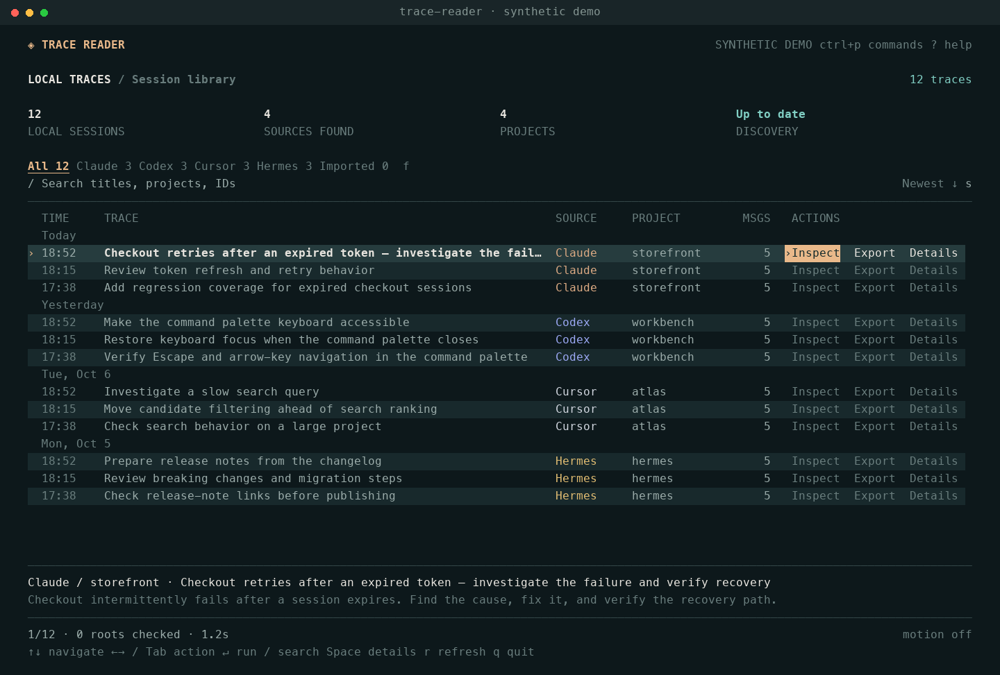

# Trace reader

A local terminal reader for saved coding-agent sessions. Find a conversation, read its recorded observations, and jump from each finding to the supporting events.

**Developer preview · local only · no account or model API key.** No network requests are made by discovery, inspection, or export.

## Run it

Requires **Node 22.13 or newer**. Node 24 LTS is a good default. Node 22 may print an experimental warning for its built-in SQLite reader; there are no native addon builds or Python requirements.

```sh
npm ci
npm run build
npm start
```

Try the library and reading flow with twelve synthetic traces across four sources, without scanning your machine:

```sh
npm run demo
# Or after building:
node dist/cli.js demo --no-motion
```



For a global command from this checkout:

```sh
npm install -g .
trace-reader
```

For development, use `npm run dev`. To make an installable archive, use `npm pack`, then `npm install -g ./trace-reader-0.1.0.tgz`.

The package is **not published**. `npx trace-reader` is the intended release experience, not an available installation command today. The registry returned no package for this name on October 6, 2026; that does not reserve it. A scoped package is the fallback.

## Browse

The TUI opens in an alternate screen and restores the terminal when it exits. The library uses a full-width, date-grouped table with **Inspect, Export, and Details on every row**. Left/right or Tab selects an action; Enter runs it. Moving to another row resets the action to Inspect. A warm accent marks focus, and the bottom preview follows the selection. Space expands source details. Roomy terminals show discovery totals; smaller windows progressively hide metadata columns while preserving all three actions. It is keyboard-first; mouse clicking is not implemented.

| Key | Action |
| --- | --- |
| `↑` / `↓`, `j` / `k` | Move between sessions |
| `/` | Search titles, project names, IDs, and preview metadata |
| `f` | Cycle source filters |
| `s` | Toggle newest/oldest order, keeping the current trace selected |
| `v` | Show/hide confirmed empty sessions |
| `←` / `→`, `h` / `l`, `Tab` / `Shift+Tab` | Choose a row action |
| `Enter` | Run the selected action; in the reading, open an observation's evidence |
| `o` | Open the selected trace directly |
| `Space` | Expand/collapse the selected row's details |
| `PgUp` / `PgDn`, `g` / `G` | Page through the library, or jump to first/last trace |
| `Ctrl+P` | Searchable command palette |
| `1` / `2` / `3`, `Tab` | Inside a trace: reading / event timeline / source data |
| `e` | Export the current session to a `.trace.json` file in the working directory |
| `r` | Refresh discovery |
| `d` | Source diagnostics |
| `?` | Help |
| `m` | Toggle reduced motion |
| `Esc` | Back / clear search |
| `q` | Back, or quit from the list |

In the reading, arrows choose observations and Enter opens evidence. `o` opens the first user message and `l` the last assistant message. In the timeline, arrows move by event, `/` searches content, `c` includes context, and `[` / `]` moves between an observation's evidence events. Space/Page Down scrolls a long output; `g`/`G` jumps to the first/last event. `p` plays or pauses event replay at 1.1 seconds per event (not original wall-clock timing). Escape returns to the reading, then the library.

A long selected title pauses, gently pans to reveal the overflow, returns, and rests. The marquee occupies only the title cells, so actions never shift. It pauses while searching or choosing another action. Activity indicators run only during work; event transitions never delay text. After the title settles, idle screens have no animation timer. `--no-motion` or `TRACE_READER_REDUCED_MOTION=1` disables animations and replay; CI and dumb terminals also default to reduced motion. The palette can change the setting during a session.

The reading currently uses **local deterministic rules, not an AI model**. It identifies structured reported errors, three or more identical tool calls, calls without a matched result, and uncertain result linkage. Every observation links to retained events. Repetition does not prove wasted work; absence of observations does not prove success. Counts describe retained message events, not necessarily distinct native messages. Time is the span between retained timestamps, not measured agent execution time. Unknown discovery counts are shown as `—`.

## Commands

```sh
trace-reader list --agent codex --since 7d --json
trace-reader list --project trace-reader --limit 100 --no-cache
trace-reader search "auth retry"
trace-reader inspect LOCAL_ID
trace-reader read LOCAL_ID --json
trace-reader read --file ./session.jsonl
trace-reader demo
trace-reader scan --root ~/Downloads --recursive
trace-reader scan --root /custom/claude/projects --agent claude-code
trace-reader import ./session.jsonl
trace-reader export LOCAL_ID --out ./session.trace.json
trace-reader export --file ./session.jsonl --out ./session.trace.json
trace-reader doctor
trace-reader adapters --json
trace-reader roots
trace-reader cache path
trace-reader cache clear
```

Without a TTY, the default command becomes a finite plain list. `--json` produces one versioned object with scan completeness and diagnostics; warnings do not corrupt stdout. `--plain` forces the line-oriented view. `NO_COLOR=1` and `--no-color` disable styling.

Default discovery hides confirmed empty, archived, and explicit child sessions. Use `--include-empty`, `--include-archived`, and `--include-children` to show them. The terminal footer reports empty sessions hidden; `v` or the command palette reveals them without another scan. Explicit inspection/export by ID can still access hidden sessions. No source files are deleted.

Empty means the adapter can establish that no conversation or tool activity was captured. Cursor database shells must declare empty conversation slots and have no associated message bubbles in either supported table or entries in their conversation map. A title or unsent draft does not make a shell a trace. Truncated, malformed, unfamiliar, or unreadable captures remain visible, as do tool-only captures and sessions referencing missing messages. This is deliberately conservative: a zero message count alone is insufficient. JSON discovery includes `scan.emptyHidden` and an optional session `activity` classification; older metadata without a classification is treated as unknown.

For sessions found through custom roots, pass the same `--root` to subsequent `inspect`/`export` commands so they can be located again. IDs remain stable for the same physical source file or database row.

Exit codes: `0` success (including an empty completed scan), `1` operational failure, `2` invalid application arguments, `3` unsupported/invalid import, `4` partial scan or bounded import/export, `130` interrupted. Inspect the diagnostics as well as the exit code. Commander may use exit code `1` for its own option syntax errors.

## Implemented sources

| Source | Discovery | Status and limits |
| --- | --- | --- |
| Claude Code | `CLAUDE_CONFIG_DIR/projects`, `~/.claude/projects` | Preview. JSONL messages, tool calls/results, explicit subagents. Unknown records are retained. |
| Codex | `CODEX_HOME/{sessions,archived_sessions}`, `~/.codex/...` | Preview. JSONL rollouts, source metadata, tools, archive and lineage flags. Duplicate message notifications are not double-counted. Inherited-history references are reported but not followed. |
| Cursor | `~/.cursor/projects/.../agent-transcripts`, OS-specific Cursor `User/globalStorage` and `workspaceStorage` | Experimental. JSONL, legacy text, composer/bubble SQLite. Format is undocumented. File transcripts and database snapshots may represent the same conversation and appear separately. |
| Hermes | `HERMES_HOME`, platform default, named profiles | Preview. Read-only `state.db` sessions/messages. Unknown schemas produce diagnostics. Legacy JSONL trajectories are not indexed. |
| Explicit imports | Selected JSON files and `.trace.json` packages | Role/content arrays and our portable JSON format. Generic JSON is never automatically assumed to be a conversation. |

Run `adapters --json` for the source-linked registry. Compatibility is fixture-tested and smoke-tested on this Mac, not a guarantee across every vendor version or OS. CI is configured for Node 22/24 on macOS, Linux, and Windows; those remote jobs have not been run from this checkout.

There is no universal trace format. Known-store discovery does not crawl the whole home directory. Explicit recursive scans use structural recognition and bounded traversal; unsupported serialization, cloud-only conversations, deleted sessions, and histories that were never saved cannot be discovered. ChatGPT exports/ZIPs, compressed Codex rollouts, Gemini, OTLP, and other harnesses are future importers.

## Data handling

- Source transcripts and databases are read only. SQLite uses a consistent read transaction, committed WAL data, schema allowlists, query-only mode, and disabled extensions. Discovery never invokes a harness, resumes a task, or changes its settings.
- A replaceable metadata index stores bounded session metadata in the OS cache directory. `--no-cache` bypasses both reading and writing it. Cached rows appear immediately, then reconcile with the current scan. Incremental per-file invalidation is not implemented yet.
- Reads are bounded: 30 seconds by default, 100,000 candidate entries, depth 10, 32 MiB per inspected transcript, 4 MiB per JSONL record, and 30,000 parsed records/events. Discovery uses smaller head reads. The CLI reports omissions; it does not claim those previews are full captures.
- Traversal skips dependency/build folders and descendant symlinks. An explicitly selected root symlink resolves once. Network-mount detection is not implemented; point scans only at local folders you intend to inspect.
- Terminal control sequences and bidirectional override characters are removed from displayed text. Imported instructions are inert data.
- Export produces a versioned package with source-addressed events and raw evidence where available. It strips recognized credential patterns and home-directory prefixes. **This is heuristic scrubbing, not guaranteed anonymization. Review exports before sharing.** Large binary attachments and all arbitrary secret formats are not comprehensively detected.
- Export creates a private file, refuses accidental overwrite, and prevents replacing its source. `--force` atomically replaces an existing destination. Nothing is uploaded.

The first portable JSON schema is provisional. It is suitable for local round-trips; a browser importer and backend still need their own validation and compatibility gates. A snapshot digest is an identity aid, not a signature or authorization mechanism.

The reading uses an internal `trace-reader/2-draft.1` projection with native tool-call IDs, source record references and explicit unknown states. The initial mappings cover Claude/Codex messages and tool events; other adapters get a conservative projection of what they expose. Unknown context/usage records are retained, not interpreted. Source-local IDs and extracted fragments are labeled. This is not a complete native normalization or a v2 export migration: `export` still produces sanitized v1 packages.

## Development

```sh
npm run check       # types, tests, build
npm run dev -- --no-cache
npm run build
node dist/cli.js --help
```

`src/adapters` owns vendor-specific formats. `src/core` owns bounded I/O, discovery, portable packages, and scrubbing. `src/ui` is a React/Ink view over those APIs. `src/cli.tsx` supplies both interactive and scriptable commands. This starts as one package; split browser-safe importers into workspace packages when the web surface exists.

Tests use synthetic fixtures created in temporary directories; no personal traces are checked in. They cover JSONL boundaries, role/tool semantics, IDs, profiles, live SQLite WAL data and unchanged source bytes, terminal safety, library interactions and resizing from 48×12 to 160×36, marquee/reduced motion, option propagation, overwrite protection, and export round-trips.
